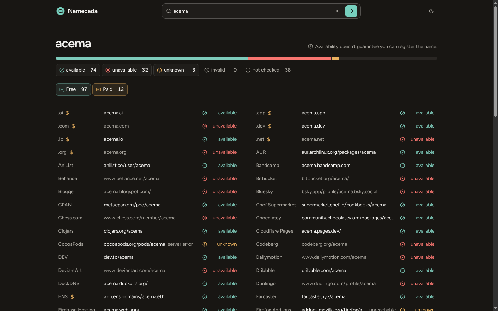

# Namecada

A name availability report across domains, usernames and package registries,
checked in one pass by a single Rust core that streams each verdict into the page
as it lands. Input is taken as-is: a source that cannot hold the name reports
`invalid` rather than checking a different one.



## Documentation

- [Sources](docs/sources.md): every source, the request it makes and the rule
  behind its verdict.
- [Architecture](docs/architecture.md): engine, adapters, caching, fixtures and
  how to add a source.
- [Platform backlog](docs/platforms.md): candidates and per-source notes.
- [Android setup](docs/android.md): SDK, NDK and Rust target for the mobile
  build.

## Development

Rust commands need `cargo` on `PATH` (rustup; `rust-toolchain.toml` pins stable).

```sh
npm install     # installs the web workspace and git hooks
npm run dev     # Vite plus the development server
npm run verify  # check, test, lint, cargo fmt/clippy/test
```

Desktop: `npm run tauri:dev` and `npm run tauri:build`. The full command list and
the dev-server/proxy modes live in [Architecture](docs/architecture.md#development).

## Contributing

Issues and pull requests are welcome. Run `npm run verify` before opening one;
commits follow Conventional Commits (`type(scope): summary`).

## License

MIT OR Apache-2.0, at your option. See [LICENSE-MIT](LICENSE-MIT) and
[LICENSE-APACHE](LICENSE-APACHE).
